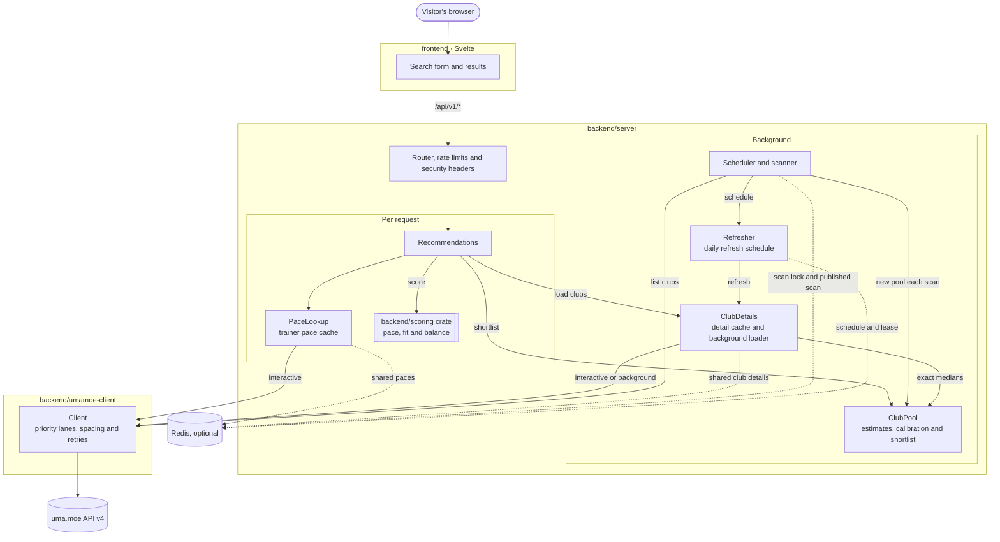

# Architecture

Uma Stable Match is one Rust server and one web page. The server scans uma.moe on a schedule, keeps club data in memory, and scores clubs for each visitor's pace with a standalone scoring crate. This page shows how the parts fit together; each part's README has the details.



The scanner fills the pool in the background, and the refresher keeps the detail cache current. A visitor's request reads both, fetches a few missing clubs if it must, and scores everything it has. The server also serves the built web page, so one process runs the whole tool.

The scanner, club details and trainer lookups read uma.moe through a `ClubSource`, and the server starts through `run(config, source)`, so the same server can run with another data source. See [Data source](backend/server/README.md#data-source) in the server README.

## Project layout

```
backend/
  scoring/         Club scoring (no network or storage dependencies)
  umamoe-client/   uma.moe API client
  server/          API server, scheduled club scanner and cache
frontend/          Web interface (Svelte + TypeScript)
observability/     Prometheus config and Grafana dashboards for local metrics
site/              Project website, published to GitHub Pages at umastable.com, with a Markdown copy for agents
docs/images/       README screenshots and the website's original artwork
```

| Part | Package | Depends on | Details |
|---|---|---|---|
| Scoring | `uma-stable-match-scoring` (library, published separately) | `serde`, optional | [backend/scoring/README.md](backend/scoring/README.md) |
| uma.moe client | `uma-stable-match-umamoe-client` (library) | scoring, `reqwest`, `tokio` | [backend/umamoe-client/README.md](backend/umamoe-client/README.md) |
| Server | `uma-stable-match-server` (binary and library) | scoring, client, `axum`, `moka`, `chrono` | [backend/server/README.md](backend/server/README.md) |
| Web page | `frontend` | Svelte, Vite | [frontend/README.md](frontend/README.md) |

The scoring crate has no network or storage code: club and member data go in, scores come out. That keeps it reusable, for example inside uma.moe's own backend, and it has its own version, minimum Rust version (1.71) and changelog.

## How club data is loaded

Once at start-up, then 30 minutes after each of uma.moe's daily updates (15:00 UTC), the scanner runs. If uma.moe hasn't updated yet, it tries again an hour later. `SCAN_INTERVAL_MINUTES` replaces this with a fixed interval. The scanner:

1. Lists clubs ranked `SCAN_RANK_FROM` to `SCAN_RANK_TO` (80 to 900) from uma.moe, 100 per page. With `SCAN_LOWER_RANK_TO` set, it carries on below the window until clubs have no fans this month, and keeps lower-range clubs only while they're still gaining fans.
2. Builds a new **club pool** from the list rows alone. Archived and unscorable clubs are left out; closed and full clubs stay, so each request can include them. Joinable, full and lower-range clubs go on separate refresh schedules. Each club gets a pace estimate from its monthly points.
3. Copies in the previous pool's exact medians, if it's for the same game month, and those of clubs still in the detail cache, then swaps the new pool in. With Redis, clubs still without one take the month's medians stored there, so a restarted instance starts with them.
4. Picks up to `SCAN_MAX_DETAILS` joinable clubs (200), best rank first, and as many full clubs. Today's pool (about 150 clubs) fits whole. It hands them to the **refresher**.

The refresher loads each club's member data in the background lane, then refreshes it once a day, 30 minutes after uma.moe's daily update (15:00 UTC), best rank first. Clubs ranked below 5,000 refresh at half speed. Full clubs have their own schedule, which the refresher only works on when no joinable club is due, always at half speed. Clubs below the window, with `SCAN_LOWER_RANK_TO`, come last, at half speed, and are refreshed every three days. A failed refresh is retried after 5 minutes, and the old data is served meanwhile. Clubs that searches load join the schedule too. `DETAIL_CACHE_MINUTES` replaces the daily timing with a fixed interval.

The private `/status`, on the metrics address, reports the running scan's phase and how many clubs it has listed and loaded. Requests are answered from step 3 on, even during the first scan; until the details catch up, they score the clubs loaded so far and report the rest as still loading. Every club whose details load gives the pool its **exact median**, and the pool recalibrates its estimates for the rest. A failed list request keeps the previous pool and results. With Redis, one instance scans for all of them; see [Caches](#caches).

## How a request is answered

`GET /api/v1/recommendations` goes through the per-visitor rate limiter and a 30-second time limit, then:

1. **Pace:** taken from the request, or worked out from the trainer's fans in their club, found through uma.moe's monthly rankings, and cached for `TRAINER_CACHE_MINUTES`.
2. **Shortlist:** the `SHORTLIST_SIZE` clubs (120) whose estimated median is nearest 0.85 × the pace.
3. **Load:** the clubs nearest the pace, twice the shortlist, are read from memory or Redis. Up to `REQUEST_FETCH_BUDGET` (10) uncached shortlisted clubs are fetched in the **interactive lane** while the visitor waits; the rest are queued for the background loader.
4. **Score:** only those clubs are scored with the scoring crate, so a search costs the same however large the pool is. Clubs further away rarely fit well, so once the cache is warm results nearly always match scoring every club. Large pools need a larger shortlist for that; see the [server README](backend/server/README.md#choosing-clubs). The trainer's own club is left out.
5. **Own club:** for a trainer lookup, their club is scored separately as if they were joining it, without their own member row.
6. **Respond:** ranked clubs, the trainer's own club, `coverage` (considered, shortlisted, scored, still loading) and the data's `month`.

`GET /api/v1/clubs/{id}` answers from clubs already in memory or Redis and never fetches one. With `trainer_id`, it looks up the trainer like a search and places them among the members.

## Caches

The server keeps everything in memory. Without Redis, restarting it starts with an empty cache and a fresh scan. With Redis, a restarted server loads the current published scan, the refresh schedule and the cached clubs from Redis instead. The bundled Redis keeps its data on disk, so they also survive a Redis restart.

| What | Key | Kept for | Where |
|---|---|---|---|
| Last scan result and error | – | Until the next scan | `cache.rs` |
| Club pool | Club ID | Until the next scan | `pool.rs` |
| Club details | Club ID and month | Until refreshed. With Redis, in memory until due for refresh, and in Redis a day longer | `details.rs`, `refresher.rs` |
| Trainer paces | Trainer ID and month | `TRAINER_CACHE_MINUTES` (10) | `pace.rs` |
| Last month's paces (priors) | Trainer or club ID, per month | One month in memory. With Redis, 14 days | `priors.rs` |
| Rate limits | Visitor IP | Per-minute quotas | `limits.rs` |

Concurrent requests for the same club share one fetch, and failed fetches aren't cached.

With `REDIS_URL` set, club details and trainer paces also go to Redis, as a second layer shared by every instance: a local miss checks Redis before uma.moe. Looked-up trainer IDs are replaced by a keyed hash, so Redis never holds them. Scans are shared too: one instance takes a lock in Redis, scans, and publishes the listed clubs, and the others build their pool from them. The refresh schedules (joinable, full and lower-range clubs) are sorted sets in Redis, and one instance at a time, holding a lease, refreshes. The club list is saved as soon as it's listed, so after a restart or crash the next instance resumes the scan instead of listing again. If Redis stops answering, each instance carries on with its own cache and scans. Rate limits are still per instance. See the [server README](backend/server/README.md#shared-cache).

## Talking to uma.moe

All calls go through the uma.moe client:

- **Spacing:** at least 500 ms between calls, shared by every caller.
- **Priority lanes:** visitors' requests use the interactive lane and always go before queued background work.
- **Retries:** 429, 500, 502, 503 and 504 responses, timeouts and connection failures are retried with backoff, respecting the full `Retry-After`.
- **Backing off:** a 429 pauses every call until `Retry-After` has passed and halves the sending rate; quiet periods bring it back gradually. Visitors' requests give up on pauses over 30 seconds instead of holding the page, and each 429 is logged with its `Retry-After`. See the [client README](backend/umamoe-client/README.md#backing-off).
- **Identification:** the `X-API-Key` header and a `uma-stable-match/<version>` User-Agent.

With the defaults, a scan makes about 160 calls (9 list pages and about 150 club details). Request volume grows with the number of distinct trainers looked up, not with visitors, because club data is shared.

## Game months

uma.moe's game month starts on the 2nd at 00:00 JST. Club details and responses always use the current game month. Early on there's too little data for a pace, so club medians blend each member's pace with last month's until a club has 6 days of data, and trainer paces until there are 10. Last month's paces are kept as priors in `priors.rs` when a club's details roll over to the new month. The [server README](backend/server/README.md#early-in-the-month) has the details.

## Web page

The page is a single Svelte app, built by Vite into static files that the server serves. It calls only `/api/v1/recommendations`.

- `SearchForm` and `SearchStatus` handle input, and loading and error states.
- `Results`, `ResultsSummary`, `ClubCard` and `ResultsTable` show the results, with the data's age and notices for clubs still loading and early-month data.
- Searches are kept in the page address, and the trainer ID and theme can be remembered in the browser.

## Build and deployment

- **Docker:** a multi-stage build. Node builds the page, Rust builds the server, and the result runs on a distroless, non-root base with only the binary and the built page. Compose runs it read-only, with no capabilities, on `127.0.0.1`, and an optional `redis` profile adds a memory-only Redis for the shared cache.
- **Fly.io:** `fly.toml` runs the Docker image on one always-on machine, with HTTPS, a health check on `/api/v1/health`, JSON logs and metrics; Fly's log shipper forwards the logs to Axiom, and Fly's managed Prometheus and Grafana collect and show the metrics. Redis runs as a second app from `deploy/redis`, with a password, append-only persistence on a volume and no public address. The live instance runs at [app.umastable.com](https://app.umastable.com).
- **Logs:** stdout, as readable text or, with `LOG_FORMAT=json`, one JSON object per line for a log search service. See the [server README](backend/server/README.md#logs).
- **Metrics:** with `METRICS_ADDR` set, the server serves Prometheus metrics on that address, apart from the app: requests by route and status code, uma.moe calls by status code with retries and wait times, rate limits, scan progress, where club details and paces come from, Redis health, the club pool and the total of searches since launch, which Redis keeps. See the [server README](backend/server/README.md#metrics), and [observability/README.md](observability/README.md) for local Prometheus and Grafana dashboards.
- **Traces:** with `OTEL_EXPORTER_OTLP_ENDPOINT` set, the server sends a span per request over OTLP/HTTP to a trace store such as Grafana Tempo. Log lines stay out of traces. See the [server README](backend/server/README.md#traces).
- **Configuration:** environment variables only, read once at start-up and validated; see [Configuration](README.md#configuration). The API key is never logged or baked into the image.
- **CI:** formatting, clippy and tests for the Rust workspace, with a Redis service container for the Redis tests; docs, minimum Rust version and a publish dry run for the scoring crate; type check, lint, tests and build for the page; and a Docker image build. After CI passes on `main`, a Deploy workflow deploys the server to Fly.io if anything it's built from changed.
