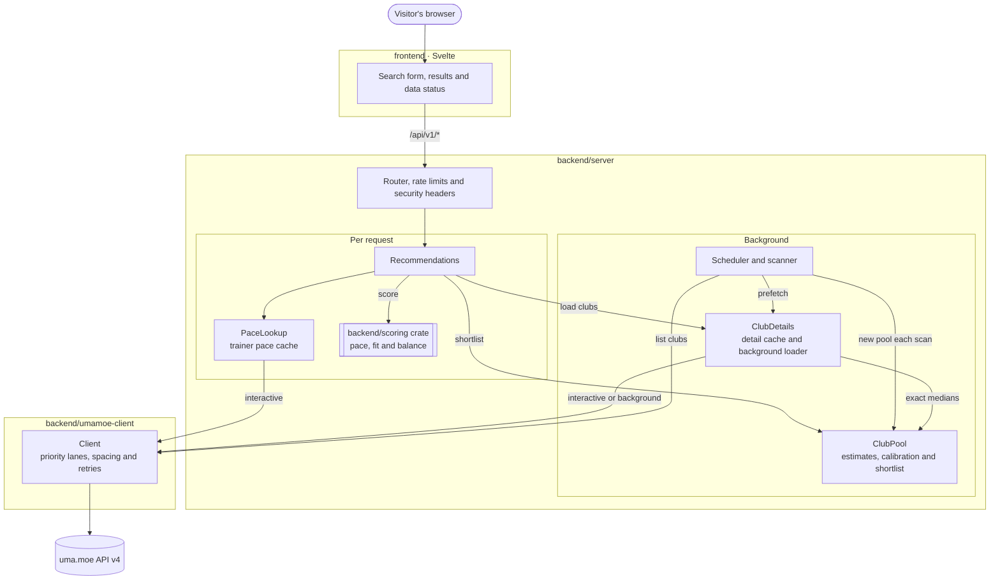

# Architecture

Uma Stable Match is one Rust server and one web page. The server scans uma.moe on a schedule, keeps club data in memory, and scores clubs for each visitor's pace with a standalone scoring crate. This page shows how the parts fit together; each part's README has the details.



The scanner fills the pool and the detail cache in the background. A visitor's request reads both, fetches a few missing clubs if it must, and scores everything it has. The server also serves the built web page, so one process runs the whole tool.

## Project layout

```
backend/
  scoring/         Club scoring (no network or storage dependencies)
  umamoe-client/   uma.moe API client
  server/          API server, scheduled club scanner and cache
frontend/          Web interface (Svelte + TypeScript)
docs/images/       README screenshots
```

| Part | Package | Depends on | Details |
|---|---|---|---|
| Scoring | `uma-stable-match-scoring` (library, published separately) | `serde`, optional | [backend/scoring/README.md](backend/scoring/README.md) |
| uma.moe client | `uma-stable-match-umamoe-client` (library) | scoring, `reqwest`, `tokio` | [backend/umamoe-client/README.md](backend/umamoe-client/README.md) |
| Server | `uma-stable-match-server` (binary and library) | scoring, client, `axum`, `moka`, `chrono` | [backend/server/README.md](backend/server/README.md) |
| Web page | `frontend` | Svelte, Vite | [frontend/README.md](frontend/README.md) |

The scoring crate has no network or storage code: club and member data go in, scores come out. That keeps it reusable, for example inside uma.moe's own backend, and it has its own version, minimum Rust version (1.71) and changelog.

## How club data is loaded

Every `SCAN_INTERVAL_MINUTES` (180 by default), and once at start-up, the scanner:

1. Lists clubs ranked `SCAN_RANK_FROM` to `SCAN_RANK_TO` (80 to 900) from uma.moe, 100 per page.
2. Builds a new **club pool** from the list rows alone. Archived, full and unscorable clubs are left out; closed clubs stay, so each request can include them. Each club gets a pace estimate from its monthly points.
3. Copies in the exact medians of clubs still in the detail cache, then swaps the new pool in.
4. Prefetches member data for up to `SCAN_MAX_DETAILS` clubs (200) in the **background lane**, spread evenly across the estimates. Today's pool (about 150 clubs) is prefetched whole.

Every club whose details load gives the pool its **exact median**, and the pool recalibrates its estimates for the rest. A failed list request keeps the previous pool and results. With Redis, one instance scans for all of them; see [Caches](#caches).

## How a request is answered

`GET /api/v1/recommendations` goes through the per-visitor rate limiter, then:

1. **Pace:** taken from the request, or looked up from the trainer's club on uma.moe and cached for `TRAINER_CACHE_MINUTES`.
2. **Shortlist:** the `SHORTLIST_SIZE` clubs (120) whose estimated median is nearest 0.85 × the pace.
3. **Load:** every cached club in the pool is used as is. Up to `REQUEST_FETCH_BUDGET` (10) uncached shortlisted clubs are fetched in the **interactive lane** while the visitor waits; the rest are queued for the background loader.
4. **Score:** every loaded club in the pool is scored with the scoring crate, so results are exact once the cache is warm.
5. **Respond:** ranked clubs plus `coverage` (shortlisted, scored, still loading) and the data's `month`.

## Caches

Everything lives in memory; nothing is written to disk. Restarting the server starts with an empty cache and a fresh scan.

| What | Key | Kept for | Where |
|---|---|---|---|
| Last scan result and error | – | Until the next scan | `cache.rs` |
| Club pool | Club ID | Until the next scan | `pool.rs` |
| Club details | Club ID and month | `DETAIL_CACHE_MINUTES` (the scan interval) | `details.rs` |
| Trainer paces | Trainer ID and month | `TRAINER_CACHE_MINUTES` (10) | `pace.rs` |
| Rate limits | Visitor IP | Per-minute quotas | `limits.rs` |

Concurrent requests for the same club share one fetch, and failed fetches aren't cached.

With `REDIS_URL` set, club details and trainer paces also go to Redis, as a second layer shared by every instance: a local miss checks Redis before uma.moe. Looked-up trainer IDs are replaced by a keyed hash, so Redis never holds them. Scans are shared too: one instance takes a lock in Redis, scans, and publishes the listed clubs, and the others build their pool from them. If Redis stops answering, each instance carries on with its own cache and scans. Rate limits are still per instance. See the [server README](backend/server/README.md#shared-cache).

## Talking to uma.moe

All calls go through the uma.moe client:

- **Spacing:** at least 500 ms between calls, shared by every caller.
- **Priority lanes:** visitors' requests use the interactive lane and always go before queued background work.
- **Retries:** 429, 500, 502, 503 and 504 responses, timeouts and connection failures are retried with backoff, respecting `Retry-After`.
- **Identification:** the `X-API-Key` header and a `uma-stable-match/<version>` User-Agent.

With the defaults, a scan makes about 160 calls (9 list pages and about 150 club details). Request volume grows with the number of distinct trainers looked up, not with visitors, because club data is shared.

## Game months

uma.moe's game month starts on the 2nd at 00:00 JST. On the 2nd and 3rd there are fewer than 3 days of data, so the scanner, the detail cache and trainer lookups all switch to the previous month together, and responses report which month they use. The [server README](backend/server/README.md#early-in-the-month) has the details.

## Web page

The page is a single Svelte app, built by Vite into static files that the server serves. It calls only `/api/v1/recommendations` and `/api/v1/status`.

- `SearchForm`, `SearchStatus` and `DataStatus` handle input, loading and error states, and data freshness.
- `Results`, `ResultsSummary`, `ClubCard` and `ResultsTable` show the results, with notices for clubs still loading and last month's data.
- Searches are kept in the page address, and the trainer ID and theme can be remembered in the browser.

## Build and deployment

- **Docker:** a multi-stage build. Node builds the page, Rust builds the server, and the result runs on a distroless, non-root base with only the binary and the built page. Compose runs it read-only, with no capabilities, on `127.0.0.1`, and an optional `redis` profile adds a memory-only Redis for the shared cache.
- **Configuration:** environment variables only, read once at start-up and validated; see [Configuration](README.md#configuration). The API key is never logged or baked into the image.
- **CI:** formatting, clippy and tests for the Rust workspace; docs, minimum Rust version and a publish dry run for the scoring crate; type check, lint, tests and build for the page; and a Docker image build.
