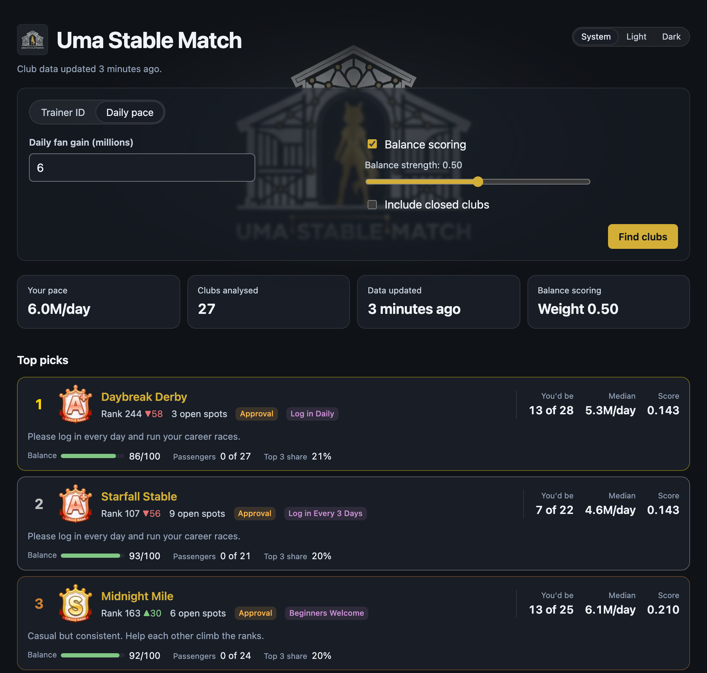
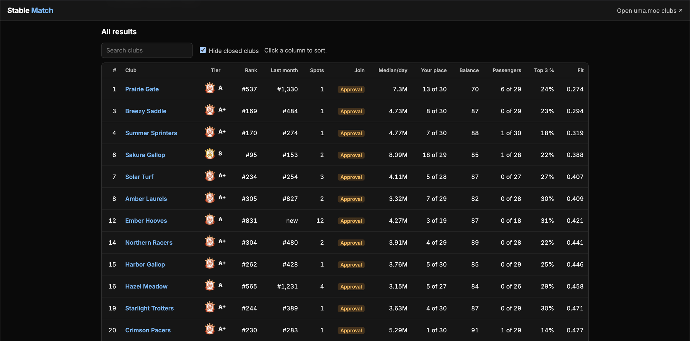

# Uma Stable Match

**Uma Stable Match: an Umamusume Pretty Derby club finder.** Uma Stable Match recommends Umamusume: Pretty Derby clubs that suit you: clubs where your fan pace fits and members pull their weight.

**Use it:** [app.umastable.com](https://app.umastable.com), in your browser with nothing to install · **Website:** [umastable.com](https://umastable.com/)



<sub>Example results page, shown with made-up clubs.</sub>

> [!IMPORTANT]
> Unofficial, non-commercial fan tool. Not affiliated with uma.moe or Cygames, Inc. See [Disclaimer](#disclaimer).

## Contents

- [Overview](#overview)
- [Features](#features)
- [Requirements](#requirements)
- [Installation](#installation)
- [Usage](#usage)
- [Understanding your results](#understanding-your-results)
- [Configuration](#configuration)
- [API](#api)
- [Tips for switching clubs](#tips-for-switching-clubs)
- [Development](#development)
- [Contributing](#contributing)
- [License](#license)
- [Disclaimer](#disclaimer)

## Overview

Club leaderboards show how big a club is, not whether it's right for you. Uma Stable Match compares your daily fan gain with the members of every club in the scanned rank range (80 to 900 by default) that has an open spot, and ranks the clubs where you'd be a solid member: secure enough not to be cut, without carrying everyone else.

Enter your trainer ID and you'll get a ranked list of clubs, each with its tier, rank trend, open spots, join style, how you'd compare with its members, and a link to the club's page on [uma.moe](https://uma.moe).

## Features

- **Personal recommendations** based on your fan pace this month
- **Open clubs first:** clubs that aren't recruiting are left out unless you ask for them
- **Current members only:** members who have left a club don't skew its numbers
- **Balance scoring:** optionally ranks clubs lower when many members barely contribute
- **Club details at a glance:** tier, rank and trend, open spots, join style, playstyle and description
- **Search and sort** all results
- **Light and dark themes**
- **Self-hostable** with Docker

## Requirements

- A free [uma.moe](https://uma.moe) account and API key ([how to get one](#1-get-a-umamoe-api-key))
- Your 12-digit trainer ID (in-game: **Menu → Profile**)
- To run it yourself: Git and Docker

### Installing Git and Docker

| Tool | macOS | Windows | Linux |
|---|---|---|---|
| Git | `xcode-select --install` (comes with Apple's command line tools) | `winget install Git.Git`, or the installer from [git-scm.com](https://git-scm.com/downloads/win) | `sudo apt install git` (Debian, Ubuntu) or `sudo dnf install git` (Fedora) |
| Docker | [Docker Desktop](https://www.docker.com/products/docker-desktop/), or `brew install --cask docker` | [Docker Desktop](https://www.docker.com/products/docker-desktop/), or `winget install Docker.DockerDesktop`. It runs on WSL 2, which the installer sets up | [Docker Engine](https://docs.docker.com/engine/install/) with the Compose plugin, or [Docker Desktop for Linux](https://docs.docker.com/desktop/setup/install/linux/) |

`brew` commands need [Homebrew](https://brew.sh). Start Docker Desktop once after installing it, so the `docker` command works.

## Installation

### 1. Get a uma.moe API key

1. Sign in at [uma.moe/login](https://uma.moe/login) with Google or Discord.
2. Go to [uma.moe/settings](https://uma.moe/settings) → **API Keys** and create a key.
3. Copy the key straight away. It's only shown once.

> [!CAUTION]
> Treat your API key like a password. Don't commit it, share it, or post it in issues. If it leaks, revoke it in uma.moe's settings and create a new one.

### 2. Download and configure

On Windows, run these commands in PowerShell.

```bash
git clone https://github.com/AbnormallyGrim/uma-stable-match.git
cd uma-stable-match
cp .env.example .env
```

Open `.env` in a text editor, such as `open -e .env` on macOS, `notepad .env` on Windows or `nano .env` on Linux, and paste your key.

```env
UMAMOE_API_KEY=your-key-here
```

### 3. Start it

```bash
docker compose up -d
```

The first build takes a few minutes. Searches work a few seconds after the server starts, once the first scan has listed the clubs. Results fill in over about 80 seconds as club details load; until then, they say how many clubs are still loading.

Open **<http://localhost:8080>** in your browser.

To stop it:

```bash
docker compose down
```

To update to the latest version:

```bash
git pull
docker compose up -d
```

### Docker details

- **Only this computer can open it.** The port is published on `127.0.0.1`. To open it from other devices, change `127.0.0.1:` to `0.0.0.0:` in `docker-compose.yml`, and only do that on a network you trust.
- **`PORT` in `.env` picks the port on your computer.** Inside the container the server always listens on `0.0.0.0:8080`, so Compose ignores `HOST` and `FRONTEND_DIR` from `.env`.
- **Logs:** `docker compose logs -f`.
- **Locked down:** the container runs as a non-root user, on a read-only file system, with no Linux capabilities. The image holds only the server and the built web page, in a minimal [distroless](https://github.com/GoogleContainerTools/distroless) base. Your `.env` is never copied into it; Compose passes the settings in when the container starts.
- **Optional metrics:** add `METRICS_PORT=9464` to `.env` to serve metrics to this computer only, for a local Prometheus and Grafana; see the [metrics dashboard guide](observability/README.md).
- **Optional Redis:** to try the [shared cache](backend/server/README.md#shared-cache), add `REDIS_URL=redis://redis:6379` and a `REDIS_KEY_SECRET` of at least 32 characters to `.env`, then start with `docker compose --profile redis up -d` (and stop with `docker compose --profile redis down`). Redis holds up to 512 MB and keeps its data in the `redis-data` volume, so club data survives restarts (`docker compose --profile redis down -v` deletes it). It isn't reachable from outside Compose, and is locked down like the server. Without the profile it doesn't run; if `REDIS_URL` is set without it, the server stops because it can't reach Redis.

## Usage

1. Open Uma Stable Match in your browser. New to it? Open **How to use** under the search form for step-by-step instructions, including where to find your trainer ID and daily pace.
2. Enter your **trainer ID**, or switch to **Daily pace** and enter your daily fan gain in millions. Tick **Remember my trainer ID on this device** to have it filled in next time.
3. Optionally turn on **Balance scoring** and adjust its strength (0–1). Higher values push clubs with many low contributors further down.
4. Optionally tick **Include closed clubs** to also see clubs that aren't recruiting, or **Include full clubs** to add clubs with no open spot to the table for comparison. Full clubs never appear as top picks.
5. Select **Find clubs**. The search is saved in the page's address, so you can bookmark or share it.
6. Browse **Top picks**, or use **Top results** to search and sort the 100 best fits.
7. Select a club's name to open its uma.moe page in a new tab, then contact the leader.

Club data refreshes automatically once a day, shortly after uma.moe's daily update, and the line under the title shows when it last did. If some clubs are still loading, or it's the first two days of a game month and results use last month's data, a note under the summary says so.

## Understanding your results



<sub>The top results table, shown with made-up clubs. Search by name, or select a column to sort. With closed clubs included, a filter can hide them again.</sub>

Above your top picks, a summary shows your pace, how many clubs were analysed (every club in the pool that your options allow), your **comfortable fits** (clubs where you'd sit 25–60% of the way down the members) and your **typical place** across your results, such as *Top 25%*.

Full clubs (30 of 30 members) aren't shown unless you tick **Include full clubs**, since there's no spot to join. Your own club is never in the results. When you search by trainer ID, a **Your club** card above the table shows where your club would sit among your results and compares its median, your place and its fit with your top pick. Matches are based on a club's typical member rather than its tier, so your best fits may be a tier or two below a high-tier club whose members are much faster than you.

| Field | Meaning |
|---|---|
| **Fit** | How well the club suits you. **Lower is better.** |
| **Your place** | Where you'd rank among the club's current members, for example *8 of 30* |
| **Median / day** | The typical member's daily fan gain this month |
| **Rank** | The club's monthly rank, with its change since last month |
| **Tier** | The club's rank tier, from D to SS |
| **Join style** | *Open* (join instantly), *Approval* (leader accepts you) or *Closed* (not recruiting) |
| **Balance** | 0–100, how evenly members contribute. **Higher is better.** |
| **Passengers** | Members gaining under 1M fans/day, or under a quarter of the club median |
| **Top 3 share** | Percentage of the club's fans coming from its three biggest contributors |

### How clubs are ranked

**Your pace** is your average daily fan gain this month. On the first two days of a game month, before there's enough data, both your pace and the clubs' data come from last month, and the results say so.

**Fit** is best when you'd sit roughly 25–60% of the way down the club's members and the club's median is a little below your pace:

```
fit = |your place ÷ club size − 0.4| + 0.3 × |club median ÷ your pace − 0.85|
```

**Balance** combines how evenly fans are spread across members (the Gini coefficient) with the share of passengers:

```
balance = 100 × (0.5 × (1 − gini) + 0.5 × (1 − passenger share))
```

With balance scoring on, the final score is:

```
score = fit + weight × (1 − balance ÷ 100)
```

**Which clubs are compared:** every club with an open spot in the scanned rank range. [ARCHITECTURE.md](ARCHITECTURE.md#how-a-request-is-answered) explains how their data is loaded.

Only **current members** count. A member counts as current if they have data on the club's most recent day, the same rule uma.moe uses. Members with fewer than 3 days of data are too new to rank, so they're placed below you and left out of the balance score.

## Configuration

Set these in `.env`. Only `UMAMOE_API_KEY` is required; [`.env.example`](.env.example) lists the rest with their defaults.

| Variable | Default | Description |
|---|---|---|
| `UMAMOE_API_KEY` | *(required)* | Your uma.moe API key |
| `HOST` | `127.0.0.1` | IP address the web page and API listen on. Ignored by the Docker setup, which always uses `0.0.0.0` inside the container |
| `PORT` | `8080` | Port the web page and API run on. With Docker, the port on your computer |
| `SCAN_INTERVAL_MINUTES` | *(none)* | How often the club list refreshes, in minutes. Unset, it refreshes once a day after uma.moe updates its data |
| `DETAIL_CACHE_MINUTES` | *(none)* | Minutes between refreshes of a club's member data. Unset, each club refreshes once a day after uma.moe updates its data |
| `SHORTLIST_SIZE` | `120` | Clubs nearest your pace considered for each search |
| `REQUEST_FETCH_BUDGET` | `10` | Most clubs loaded from uma.moe while you wait. The rest load in the background |
| `SCAN_RANK_FROM` | `80` | Best monthly rank to include |
| `SCAN_RANK_TO` | `900` | Worst monthly rank to include |
| `SCAN_MAX_DETAILS` | `200` | Most clubs whose member data is kept loaded, best rank first. The rest load when a search needs them |
| `SCAN_LOWER_RANK_TO` | none | Also list clubs below `SCAN_RANK_TO` down to this rank, for slower trainers. Listing stops early once clubs have no fans this month. Unset, only the rank window is listed |
| `TRAINER_CACHE_MINUTES` | `10` | How long a trainer's pace is reused before refreshing |
| `RATE_LIMIT_PER_MINUTE` | `30` | Requests allowed per visitor per minute |
| `TRAINER_LOOKUPS_PER_MINUTE` | `10` | Trainer ID lookups allowed per visitor per minute, not counting cached ones |
| `TRUST_FORWARDED_FOR` | `false` | Set to `true` behind a reverse proxy, so visitors are told apart by their own address |
| `LOG_FORMAT` | `text` | `json` writes logs as one JSON object per line, for a log search service. See the [server README](backend/server/README.md#logs) |
| `FRONTEND_DIR` | *(none)* | Folder with the built web page. Leave it unset to run only the API. Ignored by the Docker setup, which serves the page built into the image |
| `REDIS_URL` | *(none)* | Optional. A `redis://` or `rediss://` URL to share club data, trainer paces and scans between several servers. The server won't start if it can't reach it |
| `REDIS_KEY_SECRET` | *(none)* | Required with `REDIS_URL`: at least 32 characters, the same on every server. Looked-up trainer IDs are stored in Redis only as a hash keyed with it |
| `METRICS_ADDR` | *(none)* | Optional. An address such as `127.0.0.1:9464` to serve Prometheus metrics on, apart from the web page. See the [server README](backend/server/README.md#metrics) |
| `METRICS_PORT` | *(none)* | Docker only. Turns metrics on and publishes them on this port of your computer, such as `9464`. Compose ignores `METRICS_ADDR` |

## API

The web page is built on a JSON API you can also call directly.

### Get recommendations

```
GET /api/v1/recommendations
```

| Parameter | Required | Default | Description |
|---|---|---|---|
| `trainer_id` | yes, or `pace` | | Your 12-digit trainer ID |
| `pace` | yes, or `trainer_id` | | Your daily fan gain, if you'd rather not look up a trainer |
| `balance` | no | `false` | `true` turns on balance scoring at strength 0.5 |
| `balance_weight` | no | | Balance strength, 0–1. Setting it turns balance on |
| `include_closed` | no | `false` | Include closed clubs |
| `include_full` | no | `false` | Include full clubs |
| `limit` | no | `50` | Maximum number of clubs returned |

Example:

```bash
curl "http://localhost:8080/api/v1/recommendations?trainer_id=123456789012&balance_weight=0.6&limit=1"
```

```json
{
  "trainer": { "trainer_id": 123456789012, "pace_per_day": 7620000 },
  "options": { "balance_weight": 0.6, "include_closed": false, "include_full": false, "limit": 1 },
  "updated_at": "2026-10-19T08:00:00Z",
  "month": "2026-10",
  "coverage": { "considered": 4980, "shortlisted": 120, "scored": 240, "pending": 0 },
  "total": 236,
  "clubs": [
    {
      "circle_id": 100000001,
      "name": "Example Club",
      "url": "https://uma.moe/circles/100000001",
      "tier": "A+",
      "join_style": "approval",
      "policy": 2,
      "member_count": 29,
      "open_spots": 1,
      "monthly_rank": 111,
      "last_month_rank": 127,
      "comment": "Example description",
      "your_place": 12,
      "club_size": 30,
      "ranked_members": 28,
      "median_per_day": 5650000,
      "fit": 0.104,
      "score": 0.248,
      "balance": {
        "score": 76,
        "gini": 0.18,
        "passengers": 0,
        "counted": 28,
        "bottom_quarter_per_day": 3900000,
        "top3_share": 0.34
      }
    }
  ]
}
```

`total` is how many clubs were scored before `limit` was applied, and `coverage.considered` how many were compared with your pace. `month` is the game month the data comes from, and `coverage.pending` counts clubs that are still loading. The [server README](backend/server/README.md#recommendations) describes every field and error.

### Other endpoints

| Endpoint | Returns |
|---|---|
| `GET /api/v1/health` | `200 OK` while the server is running |

## Tips for switching clubs

- **14-day rule:** you need at least 14 days in a club during a month to receive its monthly reward, so switch early in the month.
- **24-hour cooldown:** after leaving a club you can't join another for 24 hours. Players report that being removed by the leader avoids this.
- **Month-start lock:** from 10:00 to 14:59 UTC on the 1st, you can't leave, apply to or invite to clubs.
- **Check activity first:** review members' activity scores on uma.moe before applying.

These rules can change, so check in-game if something doesn't match.

## Development

### Prerequisites

| Tool | macOS | Windows | Linux |
|---|---|---|---|
| [Rust](https://rustup.rs), stable. `rust-toolchain.toml` picks the version and adds rustfmt and clippy | `curl --proto '=https' --tlsv1.2 -sSf https://sh.rustup.rs \| sh` | `winget install Rustlang.Rustup`, or `rustup-init.exe` from [rustup.rs](https://rustup.rs) | `curl --proto '=https' --tlsv1.2 -sSf https://sh.rustup.rs \| sh` |
| A C compiler. Building the server compiles C code for TLS | `xcode-select --install` | Visual Studio Build Tools with **Desktop development with C++**; the Rust installer offers to install them | `sudo apt install build-essential` (Debian, Ubuntu) or `sudo dnf install gcc gcc-c++ make` (Fedora) |
| [Node.js](https://nodejs.org) 22.22.2 or newer, 24.15 or newer, or 26 or newer | `brew install node` | `winget install OpenJS.NodeJS.LTS`, or the installer from [nodejs.org](https://nodejs.org/en/download) | [nvm](https://github.com/nvm-sh/nvm#installing-and-updating), then `nvm install --lts`. Distribution packages are often too old |
You also need Git, and optionally Docker to build and run the image; see [Installing Git and Docker](#installing-git-and-docker). To run the Redis tests you need Redis too; the server README shows [how to run it on each platform](backend/server/README.md#redis-tests). For the optional metrics dashboard, [observability/README.md](observability/README.md) covers installing Prometheus and Grafana.

Check the versions with `rustc --version` and `node --version`.

The commands in this section are for macOS and Linux shells. On Windows, use PowerShell, and set environment variables before the command rather than in front of it: `$env:FRONTEND_DIR="frontend/dist"; cargo run -p uma-stable-match-server`.

### Architecture

[ARCHITECTURE.md](ARCHITECTURE.md) shows how the scoring crate, the uma.moe client, the server and the web page fit together, with a diagram, the project layout and how data is loaded and cached.

### Run locally

The server reads `.env` from the folder you start it in, so set up `.env` first ([step 2](#2-download-and-configure)).

```bash
# Backend
cargo run -p uma-stable-match-server

# Frontend (separate terminal)
cd frontend
npm install
npm run dev
```

Open <http://localhost:5173>. The frontend dev server forwards `/api` requests to the backend. See the [frontend README](frontend/README.md).

To run the production build the way it's deployed, build the frontend and let the server serve it:

```bash
(cd frontend && npm run build)
FRONTEND_DIR=frontend/dist cargo run -p uma-stable-match-server
```

Then open <http://localhost:8080>.

To check the Docker image builds, as CI does:

```bash
docker build -t uma-stable-match .
```

### Metrics dashboard

To see what a running server is doing, such as scan progress, uma.moe calls by status code, caches and Redis, set up Prometheus and Grafana locally and import the dashboard. [observability/README.md](observability/README.md) walks through it step by step.

### Test

```bash
cargo test
cd frontend && npm test
```

### Using the scoring crate on its own

The `scoring` crate has no network or storage dependencies. If you already have club and member data, you can score it directly. See the [scoring crate documentation](backend/scoring/README.md) for usage, input data and the scoring rules.

To browse the API documentation locally:

```bash
cargo doc -p uma-stable-match-scoring --all-features --open
```

## Contributing

Bug reports, ideas and pull requests are welcome. See the [Contributing guide](CONTRIBUTING.md) for the workflow, branch naming and checks, and ask questions in [Discussions](https://github.com/AbnormallyGrim/uma-stable-match/discussions).

To report a security issue, follow the [Security Policy](SECURITY.md) rather than opening a public issue.

This project follows the [Contributor Covenant Code of Conduct](CODE_OF_CONDUCT.md).

## License

[MIT](LICENSE) © 2026 AbnormallyGrim

The license covers this project's source code only, not Cygames' artwork or trademarks. The club tier icons in [`frontend/src/assets/tiers/`](frontend/src/assets/tiers/README.md) are © Cygames, Inc. and are excluded from the MIT license.

## Disclaimer

Uma Stable Match is an **unofficial, non-commercial fan project** and is **not affiliated with, endorsed by, or sponsored by uma.moe or Cygames, Inc.**

- **Umamusume: Pretty Derby** and all related names, characters, artwork and trademarks belong to **Cygames, Inc.** Game artwork shown by this tool, including club tier icons, is © Cygames, Inc. and is used non-commercially in line with Cygames' [Fan-Created Content Guidelines](https://umamusume.com/fan-createdguide).
- Club and trainer data comes from the [uma.moe](https://uma.moe) API and may be delayed or incomplete.
- Recommendations are estimates to help you decide, not judgements of any player or club.
- This software is provided "as is", without warranty of any kind.
- Uma Stable Match is free, with no ads or paid features.

Rights holders with concerns can [open an issue](https://github.com/AbnormallyGrim/uma-stable-match/issues), and they'll be addressed promptly.
